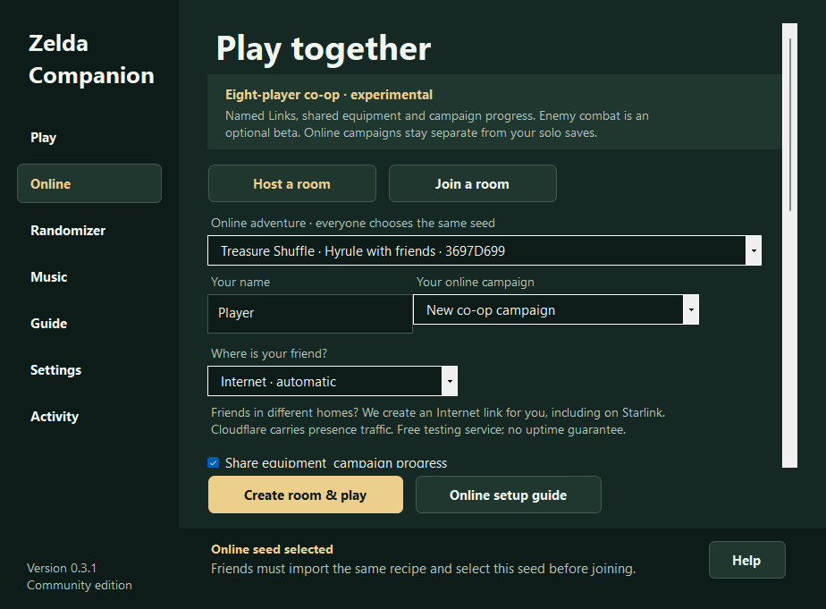
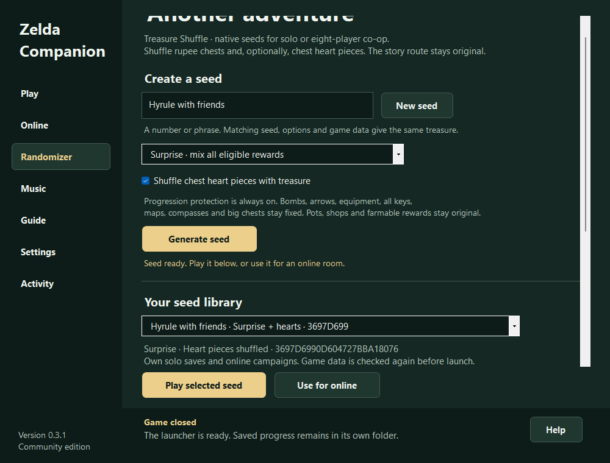

# Zelda Companion

**A native A Link to the Past port for Windows, with smooth 1080p rendering,
controller setup, MSU-1 music, protected Treasure Shuffle seeds and experimental
eight-player Internet co-op.**

**Discord:** `chrono.trigger` (project author)

Built on [snesrev/zelda3](https://github.com/snesrev/zelda3), a native C
reimplementation. The game runs locally through the native engine, with a portable
WinForms launcher for setup, controls, music and online rooms. The original
[RadzPrower launcher](https://github.com/RadzPrower/Zelda-3-Launcher) was the starting
point for this project; Companion is the new launcher.

> [!IMPORTANT]
> Bring your own original, unmodified **A Link to the Past (USA)** `.sfc` or `.smc`
> ROM. Companion verifies it and extracts the required data locally. This repo and
> its release contain no ROM, extracted game-data pack, save or soundtrack audio.
> Game assets are never uploaded by setup. Every friend supplies their own ROM.

> [!WARNING]
> **v0.3.1 is a preview.** Co-op and shared enemy combat are experiments, and a
> complete randomized solo or multiplayer campaign has not been played through.
> The verified scope is recorded in [test coverage](docs/VALIDATION.md).

## Download and play

**[Download the Windows x64 ZIP](https://github.com/rages4calm/zelda-companion/releases/download/v0.3.1/ZeldaCompanion-0.3.1-win-x64.zip)**
· [Release notes and checksum](https://github.com/rages4calm/zelda-companion/releases/tag/v0.3.1)
· [Full user guide](USER-GUIDE.md)

1. Right-click the ZIP and choose **Extract All** into a writable folder. Keep all
   folders together; do not launch from inside the ZIP.
2. Open **`Zelda Companion.exe` at the top level**. `Game/` and `Relay/` contain
   supporting software. You do not need the original GitHub build launcher.
3. On **Play**, select your own original USA ROM, choose a display preset, then
   **Launch solo**. The .NET runtime, SDL and asset tools are already bundled.
4. Use **Guide** in the sidebar, or press **F1**, for setup, online play, controls,
   music, saving and randomizer instructions. Activity and local logs explain errors.

For an existing installation, see [updating without losing progress](docs/UPDATING.md).
This unsigned community app may receive a Windows SmartScreen reputation notice;
verify the source and release checksum before running it.

## What is included

| Feature | What you can do |
| --- | --- |
| Native game | Play through the snesrev C engine, with separate solo and online executables. |
| Display | Choose Smooth 1080p, Crisp pixels or Original 4:3. Smooth uses xBRZ and a wide view; it is a pixel filter, not an HD texture replacement. |
| Controls | Visually remap keyboard, controller and engine hotkeys, including combinations. No INI editing is needed for normal bindings. |
| Music | Import a local ALttP MSU-1 ZIP/folder, set music balance or return to original SNES music. Missing tracks fall back to original music. Audio packs are not bundled. |
| Internet rooms | Host or join up to eight players through an outbound WSS connection. Automatic hosting needs no port forwarding, including the Starlink setup used during development. |
| Player identity | Eight cosmetic Link colors, Unicode nameplates and a live roster with area/activity summaries. |
| Shared progress | Optionally merge permanent gear and campaign progress. Consumables and save files remain personal. |
| Combat beta | Optional synchronization for 32 ordinary enemy types; off by default. Bosses, NPCs, puzzles and projectiles remain independent. |
| Treasure Shuffle | Reproducible rupee-chest seeds, optional chest heart pieces, mandatory progression protections, shareable recipes and isolated saves. |

## Play with friends

Use **0.3.1** on each PC. Everyone needs matching adventure data, engine,
display/aspect and gameplay settings, and progress/combat choices. Controls,
soundtracks and name visibility can differ.

- **Host:** Online → Host a room → Internet · automatic → enter a name → choose
  your adventure and a new/continued campaign → Create room & play.
- **Share:** Copy invitation and send it privately. The host keeps the launcher
  and Internet connection running.
- **Friend:** Online → Join a room → enter your name, the relay address and room
  code → match the invitation → Join room & play.
- **Meet:** Enter the same area, world and dungeon floor to see each other. Menus
  and transitions temporarily hide avatars.

Automatic hosting uses **Cloudflare Quick Tunnels**, a free testing service with
no uptime guarantee. The address changes each time; closing the host's connection
ends the link. Cloudflare carries room traffic. Same-network/LAN mode and a
self-hosted permanent WSS relay are also available. No permanent hosted service,
automatic reconnect, matchmaking or anti-cheat is included. See the
[online guide](USER-GUIDE.md#up-to-eight-players-over-the-internet-including-starlink).

*Actual v0.3.1 launcher capture. This is a local setup screen with a demonstration
seed, not proof of a completed multiplayer campaign.*

## Randomizer with progression protection

**Treasure Shuffle v1** moves only rupee rewards in **46 ordinary chests**. The
optional heart-piece setting adds six chest locations, for **52** eligible chests.
Both styles preserve the original reward totals.

Required equipment, all small/big keys, maps, compasses, every big chest,
bomb/arrow chest supplies, pots, shops, farmable rewards, entrances and story
events stay original. These protections **cannot be disabled**. No required item
is relocated behind a dependency for that item.

Generate a seed on **Randomizer**, then Play selected seed. Export its small
`.z3seed.json` recipe for friends to import using their own USA data. Select it on
Online; mismatched asset hashes are rejected. Every seed has separate solo saves
and online campaigns. The normal Play page continues your original adventure.

*Actual v0.3.1 launcher capture after a short native seed-launch test. Existing
original saves were kept separate. It does not establish a full playthrough.*

The established [ALttPR](https://alttpr.com/en/start) generator produces patched
SNES ROMs and has a much larger item/logic feature set. Its patches and seed codes
do not run in this native engine. Treasure Shuffle is an independent, smaller
generator. [Rules, saves and verification](RANDOMIZER.md).

## Saves and testing limits

Original solo saves live in `Game/saves`; original online campaigns live in
`UserData/Online`. Treasure Shuffle uses a separate namespace for each seed.
Save normally before closing; the launcher backs up saves before launching.
Exported recipes contain no saves or game assets.

The eight-player release passed 51 protocol checks, eight local native-engine
sessions and eight clients through a public WSS tunnel. A previous release
connected the author and a friend on separate computers. The new eight-player
version still needs longer multi-PC, latency, boss/puzzle and campaign testing.
Co-op progress is permanent in the selected campaign; save-state rewinds can
reintroduce divergence.

The shuffle passed **1,000 seeds across all four option combinations**, checking
every protected byte and reward total. Five fixture seeds passed **840 native
chest lookups and 260 reward receipts**. The clean release also passed first-run
ROM extraction and an actual native seed launch. These are bounded checks, not a
completed campaign. [Detailed coverage](docs/VALIDATION.md).

## Source, contributions and credits

- [Building and development](BUILDING.md) — .NET 10, native C build and ROM-free checks.
- [Compatibility research](RESEARCH.md) — native ports, ALttPR, Z3R and co-op references.
- [Changelog](CHANGELOG.md) · [Contributing](CONTRIBUTING.md) · [Security reporting](SECURITY.md).
- [Credits](CREDITS.md) · [Source lineage](UPSTREAMS.txt) · [Legal and licensing scope](LEGAL.md).

Companion and the new network/shuffle code: **Carl Prewitt Jr.** Native engine:
**snesrev and elzo_d**. Original launcher: **RadzPrower**. Upstream source and
third-party notices are retained. Original project code is MIT; dependencies and
shader components retain their separate licenses.

An unofficial fan project, with no affiliation with or endorsement by Nintendo.
No ownership of the original game is claimed. Do not attach ROMs, generated game
assets, soundtracks, private invitations or unredacted personal logs to issues.

## Community

**[R.A.I.D. — Retro AI Development](https://discord.gg/Ad9BwSzctP)** · a Discord for AI-assisted retro reverse-engineering, decomp & recomp.

I post all my work there. Join to discuss projects, ask questions, and share ideas.
